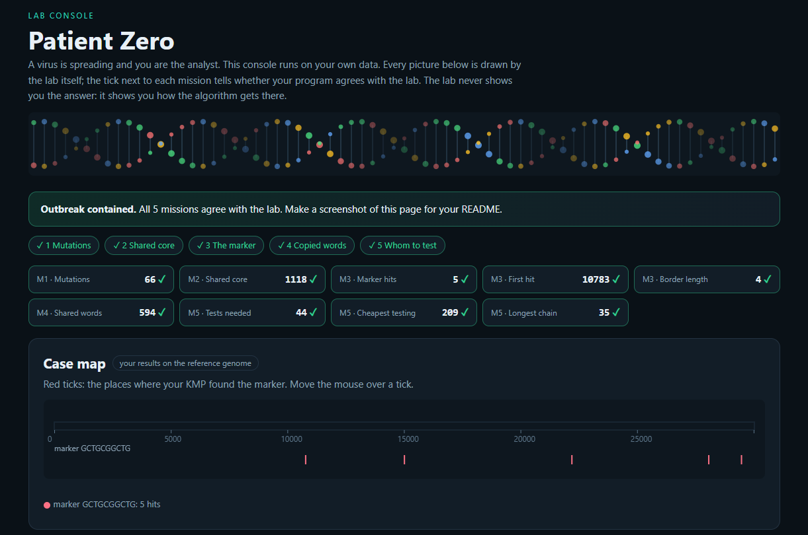

# Assignment 4. Patient Zero

Student ID:250593

Name:Alisher Kairov

Group: SE-2519

## Program output

    Mutations: 66
    Shared core: 1118
    Marker hits: 5
    First hit: 10783
    Border length: 4
    Shared words: 594
    Tests needed: 44
    Cheapest testing: 209
    Longest chain: 35

My outbreak report (a screenshot of `output/outbreak.html`):

## Questions

**Mission 1.** What does the cell d[i][j] of your table mean, and how is it computed from other cells?

d[i][j] is the minimum number of changes needed to change the first i letters of A into the first j letters of B. We calculate it using the cells above, left, and diagonal. These cells mean delete, insert, or replace a letter.

**Mission 2.** How is the longest common subsequence different from the longest common substring? My Shared core is bigger than the number of letters that are the same at the same place: why?

A subsequence keeps the same order, but its letters do not need to be next to each other. A substring is continuous. The Shared core can be longer than the number of letters in the same positions because letters can match at different positions in the two strains.

**Mission 3**. What does the prefix function tell you, and why does the pointer in the text never go back in KMP? What is the Border length of my marker and what does it mean?

The prefix function shows the length of the longest proper prefix that is also a suffix for each part of the marker. In KMP, the text pointer never goes back because the prefix function tells us where to continue in the marker after a mismatch. The Border length is the last value of the prefix function. It tells me the length of the longest proper prefix of my marker that is also its suffix.

**Mission 4.** Why must you compare the letters after the hashes are equal? What happens to the cost of Rabin-Karp if many windows have the same hash?

We must compare the letters because different words can have the same hash. If many windows have the same hash, we must compare more letters, so Rabin-Karp becomes slower. In the worst case, its time can be O(nk).

**Mission 5.** What are the two states of a person in your DP, and how do you get the answer for a person from its children? Why does a greedy "test the person with most links first" not always give the cheapest answer?

For each person, the DP has two states: tested and not tested. If a person is tested, each child can be tested or not; if the person is not tested, every child must be tested. A greedy choice may cost more because testing one person can be more expensive than testing several connected people.

## AI use

none

## Timing (Mission 7)

Milliseconds, average of 3 runs, from `java -cp out Bench`.

| test | size | time                   |
|---|---|------------------------|
| naive search | 20 000 / 40 000 / 80 000 | 67,4 /  109,0 /  203,3 |
| KMP | 20 000 / 40 000 / 80 000 | 1,8 / 1,6 / 0,4        |
| edit distance | 500 / 1000 / 2000 / 4000 | 5,4 / 7,0 / 18,2 / 70,1    |

The naive search takes about twice as long when the text size doubles. KMP stays very fast, and the small differences are probably measurement noise. When the strain length doubles, edit distance takes about four times longer for the larger sizes.

## Complexity

n is the length of the text (or of a strain), m the length of the pattern, k the length of the window, v the number of people. Fill in every algorithm you wrote.

| algorithm | time | space | assumptions |
|---|---|---|---|
| Edit distance |	O(nm) |	O(nm) |	n and m are the lengths of the two strains |
| LCS |	O(nm) | O(nm)|	n and m are the lengths of the two strains |
| Prefix function and KMP |O(n + m) |O(n + m) | 	n is the text length, m is the marker length|
| Rabin-Karp (shared words) |O(nmk) worst case|O(m) | 	n and m are the lengths of strains A and B; k is the window length. Hash collisions may require letter comparisons.|
| Tree DP | O(v)|	O(v) |v is the number of people in the tree |

